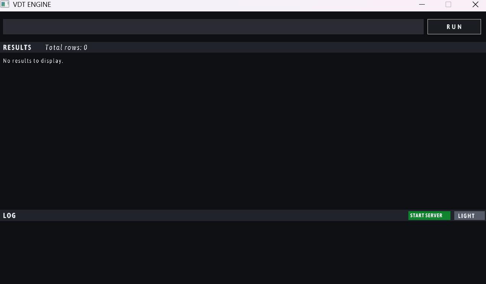
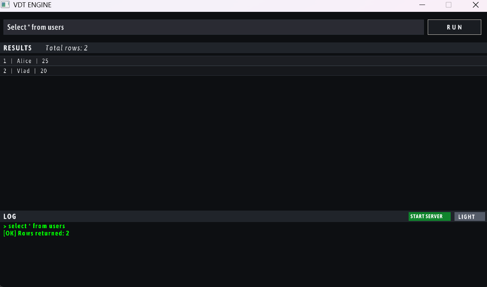
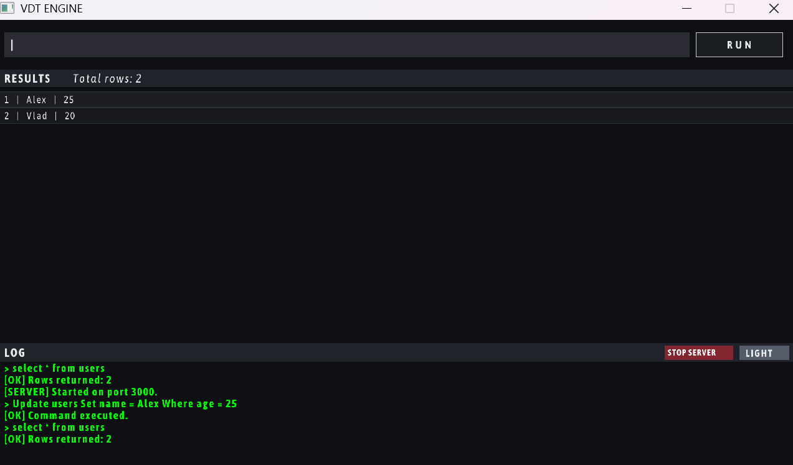

# NexDB

A lightweight relational database engine written in **C++23**, built for use in MVPs and small projects where you need a simple, embedded database with an interactive GUI and remote access over TCP.

---

## What is this?

NexDB is a self-contained SQL database engine you can drop into a project and run locally. It exposes a **TCP server** so any application — regardless of language — can send SQL queries and receive results as line-delimited JSON. It also ships with a **VS Code-style GUI** (built on Raylib) for writing queries, browsing databases and inspecting results.

It is intentionally minimal. No heavy dependencies, no installation. Compile and run.

---

## Why use it in an MVP?

- Zero infrastructure — runs as a single binary on any Windows machine
- Remote access via TCP — connect from C#, Python, Node, or anything that can open a socket
- Persistent storage with WAL-based crash recovery and fsync durability
- B+ tree indexing for fast primary key lookups
- Real SQL `NULL`, negative numbers, column lists in `INSERT`, affected-row counts
- Thread-safe — every query, local or remote, runs under one engine lock
- Challenge-response authentication with rate limiting and IP banning
- Configurable via `config.json` — no recompilation needed
- GUI for quick manual queries during development

---

## Interface

The GUI is laid out like VS Code: a custom title bar, a database **explorer** on the left, a
**center panel** with the results, the query editor and the log, a **side panel** on the right
(reserved for future features) and a **status bar**.

```
┌─ NexDB ─────────────────── mydb — NexDB ───────────── [◧][◨]  ─  □  ✕ ┐
│ ╭ EXPLORER ─────╮ ╭ RESULTS ─────────────── 3 rows · 0.4 ms ╮ ╭ PANEL ─╮ │
│ │ ▾ ⛁ mydb      │ │  #  id  name    age                     │ │        │ │
│ │   ▸ ▦ users   │ │  1  1   Alice   30                      │ │        │ │
│ │   ▾ ▦ orders  │ ├ QUERY ──────────────── Ctrl+Enter [▶Run]┤ │        │ │
│ │       • id INT│ │ 1  SELECT * FROM users                  │ │        │ │
│ │ ▸ ⛁ other     │ │ 2  WHERE age > 18                       │ │        │ │
│ │               │ ├ LOG ─────────────────────────── [Clear] ┤ │        │ │
│ │               │ │ > SELECT * FROM users WHERE age > 18    │ │        │ │
│ │               │ │ [OK] Rows returned: 3 (0.41 ms)         │ │        │ │
│ ╰───────────────╯ ╰─────────────────────────────────────────╯ ╰────────╯ │
│ ● Server: port 3000   DB: mydb                   Ln 2, Col 17  Theme: Dark│
└───────────────────────────────────────────────────────────────────────────┘
```





*The screenshots still show the previous layout and will be replaced.*

### Window

- The title bar is custom (undecorated window): **drag** it to move the window, **double-click**
  it to maximize / restore, and use the **minimize**, **maximize / restore** and **close**
  buttons on the right. Maximize fills the screen without covering the taskbar; dragging a
  maximized window restores it under the cursor, like Windows does.
- Resize the window from any **edge or corner**.
- The two icons next to the window buttons open and close the **explorer** and the **right
  panel**. The center panel animates to fill the freed space.
- Every border is **draggable**: explorer width, right panel width, and the splits between
  results, editor and log.
- Windows snapping (Win+Arrow, dragging to a screen edge) is not available for the custom
  title bar.

### Explorer (left)

Every database in `databases/`, expandable into its tables and then their columns with their
types. The active database is highlighted.

- Click the **chevron** to expand or collapse a node.
- Click **another database** to run `USE` on it.
- Click a **table** to run `SELECT * FROM` it (switching database first if needed).
- The tree refreshes after every query, every 2 seconds (network clients can change the
  schema too), and from the refresh button.

### Center panel

- **Results** — a grid with aligned columns, a sticky header and a row number column.
  Scroll vertically with the wheel, horizontally with **Shift+wheel**. SQL `NULL` is drawn
  *italic and dimmed*, so it never looks like the string `'NULL'`. Statements without rows
  show their outcome here (`Rows affected: 2`, `Table created`, or the error in red), and the
  header shows the row count and the execution time.
- **Query** — a multi-line editor with line numbers and SQL highlighting. Statements are
  separated by `;` and run in order; the script stops at the first error. If text is
  selected, only the selection runs. The text stays in the editor after running.
- **Log** — every statement, its outcome and timing, plus server messages, color-coded.

### Status bar

Server state and port (**click to start or stop** the TCP server), the active database, the
editor cursor position, the UI zoom (only shown when it is not 100%), and the theme
(**click to switch** dark / light).

### Keyboard shortcuts

| Shortcut | Action |
|---|---|
| `Ctrl+Enter` / `F5` | Run the editor (or the selection) |
| `Ctrl+Up` / `Ctrl+Down` | Previous / next query from history |
| `Ctrl+B` | Toggle the explorer |
| `Ctrl+Alt+B` | Toggle the right panel |
| `Ctrl` + mouse wheel | Zoom the whole interface (80–200%, capped by what fits on the screen; saved in `gui_settings.ini`) |
| `Ctrl+A` / `Ctrl+C` / `Ctrl+X` / `Ctrl+V` | Select all / copy / cut / paste |
| `Ctrl+Z` / `Ctrl+Y` (or `Ctrl+Shift+Z`) | Undo / redo |
| `Ctrl+Left` / `Ctrl+Right` | Move by word |
| `Ctrl+Backspace` / `Ctrl+Delete` | Delete by word |
| `Home` / `End`, `Ctrl+Home` / `Ctrl+End` | Line start / end, document start / end |
| `Shift` + any movement, mouse drag | Extend the selection |
| Double-click a word | Select the word |

---

## What's new in this version

### VS Code-style GUI
The GUI was rebuilt around the layout described in [Interface](#interface): custom title bar,
explorer, results / editor / log center panel, right panel, status bar, draggable splits and
collapsible side panels. The fonts now include Romanian diacritics (ă â î ș ț).

The GUI now takes the **same lock as network clients** before touching the engine. Before, a
query typed in the GUI could run at the same time as a remote one. A `USE` run from the GUI no
longer leaves a pending switch behind (the next network client used to receive it as the answer
to its own query), the generated auth token is written to the log, and the log is no longer
written without its mutex.

### Real `NULL`
Unquoted `NULL` is now a real SQL NULL, valid in every column type and distinct from the string
`'NULL'`:

```sql
INSERT INTO products VALUES (2, 'Out of stock', NULL, false)
SELECT * FROM products WHERE price IS NULL
SELECT * FROM products WHERE price IS NOT NULL
UPDATE products SET price = NULL WHERE id = 3
```

Comparisons follow SQL rules: `WHERE price = NULL` matches nothing, and `price != 5` does not
match rows where `price` is NULL. Over the network, NULL is a bare JSON `null`; the string
`'NULL'` stays `"NULL"`.

### Negative numbers
A sign written directly against a digit is part of the number: `VALUES (1, -5)` stores `-5`
and `WHERE price > -0.5` compares against `-0.5`. Before, the `-` was silently dropped. `+5`
is accepted and stored as `5`.

### `INSERT` column lists
`INSERT INTO users (name, id) VALUES ('Alice', 1)` places each value in the column it names, in
any order. Columns left out are set to `NULL`. An unknown or repeated column is an error.
Before, the list was ignored and values were applied positionally.

### Affected-row counts and clearer errors
`INSERT`, `UPDATE` and `DELETE` now answer `{"type": "ok", "affected": N}`; `0` means nothing
matched and is not an error. `UPDATE` with an unknown column or a value of the wrong type is now
an error instead of a silent `ok`, and a `WHERE` on a column that does not exist is an error for
`SELECT`, `UPDATE` and `DELETE` instead of quietly returning no rows.

### WAL fixes
- Recovery used to rebuild statements without quotes, so any string with a space, comma,
  quote or an empty value failed to replay and the row was lost. Values are now quoted.
- The first statement after startup was missing from the WAL (the stream was left in a
  failed state after reading the log), so it was not protected against a crash.
- A logged statement that fails on replay is now skipped with a message instead of aborting
  startup.
- An empty string in the last column no longer comes back one column short.

### `DROP DATABASE` command
Deletes a database and every file behind it (`.db`, `.cat`, `.wal`):

```sql
DROP DATABASE myproject
```

Available **from the GUI**; network clients are refused unless `allow_remote_db_admin` is on
(see the next section).

This is **irreversible and unconfirmed** — there is no `IF EXISTS`, no soft delete, and no
recycle bin. The statement is not written to the WAL, so it is never replayed on recovery.

Two guards apply, in this order:

1. **The active database cannot be dropped.** Its files are open, so Windows would refuse
   the delete anyway. Attempting it returns
   `Cannot drop the currently active database '<name>' (USE another database first)`.
   The comparison is case-insensitive, because Windows filenames are — `mydb` and `MyDB`
   name the same files, so both are rejected while `mydb` is active.
2. **The database must exist.** Dropping a name with no `.db` file returns
   `Database '<name>' does not exist` instead of silently reporting success.

Note that the active database is **process state**, set by `USE` and shared by every
connection — and `USE` is *not* blocked for network clients. So a `DROP DATABASE` typed in
the GUI can fail because a remote client switched the active database a moment earlier.

### `CREATE DATABASE` / `DROP DATABASE` are blocked for network clients
Creating and destroying databases is an operator action, not something a connected client
can do. Both statements still parse; `Engine::query` refuses them afterwards, based on the
statement type, before anything runs:

```json
{"type": "error", "message": "CREATE DATABASE/DROP DATABASE is not permitted for remote clients"}
```

Since the check reads the parsed statement rather than the query text, case and spacing cannot
get around it — `create database x` and `   CrEaTe   DaTaBaSe   x` are refused identically.
Nothing is created, deleted or switched, and the refusal is an ordinary error response, so the
connection stays open and usable. Setting `allow_remote_db_admin` to `true` in `config.json`
lifts the restriction.

The GUI runs on the same engine and is unaffected: locally both statements work exactly as
described above. `USE` is deliberately still allowed over the network, so clients can move
between existing databases — they just cannot add or remove any.

### Protocol version banner
Every connection begins with a version line (`NEXDB/1.0.0\n`) before authentication,
so clients can detect an incompatible server up front instead of failing on a malformed
response. The protocol version is bumped whenever the wire format changes incompatibly;
added fields (like `affected`) do not bump it.

### Column headers in results
`SELECT` responses include a `columns` array alongside the row values
(`{"type": "rows", "columns": ["id", "name"], "rows": [...]}`), so clients can build named
objects like `{id: 1, name: "Alice"}` instead of positional arrays. A `SELECT` matching no
rows still returns the header with an empty `rows` array.

### Multi-table database files
All tables of a database share a single `.db` file. Pages are tagged with a `tableId` in the page header — the storage layer allocates and reclaims pages per table automatically.

### `databases/` folder
All database files (`*.db`, `*.cat`, `*.wal`) are stored inside a `databases/` subdirectory, created automatically on startup. The database opened at startup is selected via `config.json`.

### `CREATE DATABASE` / `USE DATABASE` commands
Two SQL commands for managing multiple databases:

```sql
CREATE DATABASE myproject
USE DATABASE myproject
USE myproject
```

`CREATE DATABASE` creates the database files on disk (GUI only by default, see above). `USE`
switches the engine to another database and answers `{"type": "switch", "db": "<name>"}`.
The switch applies to **every** connected client and to the GUI, not only to the connection
that sent it.

### Localhost bypass
Connections from `127.0.0.1` or `::1` skip the challenge-response handshake and receive `AUTH OK` immediately. This makes local tooling (scripts, test clients) simpler. Remote connections still require full authentication.

### FLOAT and BOOL column types
Two column types in addition to `INT` and `STRING`:

- `FLOAT` — stores decimal numbers (e.g. `3.14`, `-0.5`)
- `BOOL` — stores boolean values: `true`, `false`, `1`, `0`, `TRUE`, `FALSE`

### Concurrent connections
The TCP server runs an ASIO I/O thread pool. The number of threads is set via `thread_count` in `config.json` (default 4). Multiple clients are handled simultaneously; queries are serialized by one engine mutex, which the GUI shares.

### Atomic DELETE and UPDATE (WAL)
DELETE and UPDATE operations are fully atomic. The WAL logs the complete post-operation state before modifying storage using a `REPLACE_BEGIN` / `REPLACE_ROW` pattern. On crash recovery, the engine can always restore the correct final state without data loss or partial writes. WAL values are percent-encoded to safely handle any delimiter characters inside stored data.

---

## Configuration

NexDB reads `config.json` from the same directory as the executable at startup. If the file is missing, built-in defaults are used.

```json
{
  "port": 3000,
  "page_size": 4096,
  "cache_capacity": 128,
  "aux_max_failures": 3,
  "aux_timeout": 30,
  "thread_count": 4,
  "handshake_timeout": 5,
  "bypass_localhost": true,
  "allow_remote_db_admin": false,
  "database": "mydb"
}
```

| Field | Default | Description |
|-------|---------|-------------|
| `port` | `3000` | TCP port the server binds to |
| `page_size` | `4096` | Storage page size in bytes (must match build) |
| `cache_capacity` | `128` | Number of pages held in LRU cache |
| `aux_max_failures` | `3` | Failed auth attempts before IP ban |
| `aux_timeout` | `30` | Ban duration in seconds |
| `thread_count` | `4` | Number of threads in the ASIO I/O thread pool |
| `handshake_timeout` | `5` | Seconds a client has to answer `CHALLENGE` with `AUTH` before the server closes the connection. Does not count toward the IP ban |
| `bypass_localhost` | `true` | Skip the auth handshake for `127.0.0.1` / `::1` connections |
| `allow_remote_db_admin` | `false` | Let network clients run `CREATE DATABASE` / `DROP DATABASE`. Off by default; the GUI is unaffected either way |
| `database` | `"mydb"` | Database opened at startup (files stored in `databases/`) |

An **unknown key aborts startup** rather than being ignored, so a typo cannot silently leave a
setting at its default. The error names the offending key.

---

## TCP Protocol

The server listens on the port configured in `config.json` (default 3000). Start it from the
GUI status bar. The full client-side specification — every response shape, edge case and a
checklist for client authors — is in [`docs/CLIENT_PROTOCOL.md`](docs/CLIENT_PROTOCOL.md).

### Protocol banner

The **very first line** on any connection — before authentication — is the protocol
version, so clients can detect incompatible servers early:

```
Server → Client:  NEXDB/1.0.0\n
```

A client should read this line first and verify the major version matches what it
supports.

### Authentication

Connections from **localhost** (`127.0.0.1` / `::1`) receive `AUTH OK` immediately after
the banner — no handshake required (controlled by `bypass_localhost` in `config.json`):

```
Server → Client:  NEXDB/1.0.0\n
Server → Client:  AUTH OK\n
```

Remote connections must complete a challenge-response handshake after the banner:

```
Server → Client:  NEXDB/1.0.0\n
Server → Client:  CHALLENGE <16-byte-hex-nonce>\n
Client → Server:  AUTH <SHA256(secret + nonce)>\n
Server → Client:  AUTH OK\n   (or AUTH FAIL\n / AUTH BANNED\n)
```

The shared secret is auto-generated on first run, saved to `server_auth.conf` and written to
the GUI log at that moment (later starts only log that it was loaded). You can override it by
setting the `VDT_AUTH_TOKEN` environment variable.

After 3 failed attempts the IP is banned for 30 seconds (configurable via `config.json`). A
client that does not answer the challenge within `handshake_timeout` seconds is disconnected.

### Queries

After `AUTH OK`, send one SQL statement per line, terminated with `\n`:

```
SELECT * FROM users WHERE age > 18\n
```

**Response formats:** every response is a **single line of JSON** terminated by `\n`.

| Case | Response |
|------|----------|
| Success, no rows (DDL: CREATE/DROP) | `{"type": "ok"}` |
| Success, INSERT / UPDATE / DELETE | `{"type": "ok", "affected": <rows touched>}` |
| Success, with rows | `{"type": "rows", "columns": ["id", "name"], "rows": [["1", "Alice"], ["2", null]]}` |
| Database switch (`USE`) | `{"type": "switch", "db": "<dbname>"}` |
| Error | `{"type": "error", "message": "<message>"}` |

A `rows` response always carries a `columns` header listing the column names in the same
order as the values in each row — so a client can build `{id: 1, name: "Alice"}` objects
instead of positional arrays. A `SELECT` that matches no rows still returns a `rows`
response with the header and an empty `rows` array (`{"type": "rows", "columns": [...], "rows": []}`);
only non-SELECT commands (INSERT/DELETE/…) return `ok`. INSERT, UPDATE and DELETE add an
`affected` row count (`0` when nothing matched); DDL statements do not.

Every value is a **JSON string**, except SQL `NULL`, which is a bare **JSON `null`**: `42`
comes back as `"42"`, `true` as `"true"`, the string `'NULL'` as `"NULL"`. All values are
JSON-escaped, so any character — including `|`, newlines, or the literal text `END` — is
safe inside a value. Clients read one line and parse it with a standard JSON parser
(`JSON.parse`, `json.loads`, `System.Text.Json`, …).

An `error` does not close the connection; it stays usable for the next query.

---

## Connecting from C#

### Basic connection helper (with auth)

```csharp
using System.Collections.Generic;
using System.Linq;
using System.Net.Sockets;
using System.Text;
using System.Text.Json;
using System.Security.Cryptography;

public class NexDBClient : IDisposable
{
    private readonly TcpClient _client;
    private readonly NetworkStream _stream;
    private readonly StreamReader _reader;
    private readonly StreamWriter _writer;

    public NexDBClient(string host, int port, string secret)
    {
        _client = new TcpClient(host, port);
        _stream = _client.GetStream();
        _reader = new StreamReader(_stream, Encoding.UTF8);
        _writer = new StreamWriter(_stream, Encoding.UTF8) { AutoFlush = true };

        // 1. Protocol banner — always the first line. Verify the major version.
        string banner = _reader.ReadLine()!; // "NEXDB/1.0.0"
        if (!banner.StartsWith("NEXDB/1."))
            throw new Exception("Unsupported server protocol: " + banner);

        // 2. Next line is either AUTH OK (localhost bypass) or a CHALLENGE.
        string next = _reader.ReadLine()!;
        if (next == "AUTH OK")
            return; // localhost bypass — no handshake needed

        if (next.StartsWith("CHALLENGE "))
        {
            string nonce = next.Split(' ')[1];
            string hash = ComputeSha256(secret + nonce);
            _writer.WriteLine("AUTH " + hash);

            string authResult = _reader.ReadLine()!;
            if (authResult != "AUTH OK")
                throw new Exception("Authentication failed: " + authResult);
        }
        else
        {
            throw new Exception("Unexpected handshake response: " + next);
        }
    }

    private static string ComputeSha256(string input)
    {
        byte[] bytes = SHA256.HashData(Encoding.UTF8.GetBytes(input));
        return Convert.ToHexString(bytes).ToLower();
    }

    // Column names from the last `rows` response (empty for non-SELECT commands).
    public string[] Columns { get; private set; } = Array.Empty<string>();

    // Rows touched by the last INSERT / UPDATE / DELETE; null for anything else.
    public int? Affected { get; private set; }

    // Values are strings, or null for SQL NULL.
    public List<string?[]> Query(string sql)
    {
        _writer.WriteLine(sql);

        // Each response is a single line of JSON.
        string line = _reader.ReadLine() ?? throw new Exception("Connection closed by server");

        using var doc = JsonDocument.Parse(line);
        JsonElement root = doc.RootElement;
        string type = root.GetProperty("type").GetString()!;

        Columns = Array.Empty<string>();
        Affected = null;

        switch (type)
        {
            case "ok":
                if (root.TryGetProperty("affected", out JsonElement affected))
                    Affected = affected.GetInt32();
                return new List<string?[]>();
            case "switch":
                return new List<string?[]>();
            case "error":
                throw new Exception(root.GetProperty("message").GetString());
            case "rows":
                Columns = root.GetProperty("columns")
                    .EnumerateArray().Select(c => c.GetString()!).ToArray();

                var rows = new List<string?[]>();
                foreach (var row in root.GetProperty("rows").EnumerateArray())
                    rows.Add(row.EnumerateArray().Select(cell => cell.GetString()).ToArray()); // null stays null
                return rows;
            default:
                throw new Exception("Unknown response type: " + type);
        }
    }

    // Convenience: returns each row as a column-name → value dictionary,
    // e.g. { "id": "1", "name": "Alice" }.
    public List<Dictionary<string, string?>> QueryObjects(string sql)
    {
        var rows = Query(sql);
        return rows.Select(r =>
        {
            var obj = new Dictionary<string, string?>();
            for (int i = 0; i < Columns.Length && i < r.Length; i++)
                obj[Columns[i]] = r[i];
            return obj;
        }).ToList();
    }

    public void Dispose()
    {
        _reader.Dispose();
        _writer.Dispose();
        _stream.Dispose();
        _client.Dispose();
    }
}
```

### Usage example

```csharp
// Secret is in server_auth.conf next to the executable
string secret = File.ReadAllText("server_auth.conf").Trim();

using var db = new NexDBClient("127.0.0.1", 3000, secret);

db.Query("CREATE TABLE users (id INT, name STRING, age INT, score FLOAT, active BOOL)");
db.Query("INSERT INTO users VALUES (1, 'Alice', 30, 9.5, true)");
db.Query("INSERT INTO users VALUES (2, 'Bob', 25, -7.2, false)");
db.Query("INSERT INTO users (id, name) VALUES (3, 'Carol')");   // age, score, active = NULL

// Positional rows + the column header
var rows = db.Query("SELECT * FROM users WHERE age > 20");
Console.WriteLine(string.Join(" | ", db.Columns));   // id | name | age | score | active
foreach (var row in rows)
    Console.WriteLine(string.Join(" | ", row.Select(v => v ?? "NULL")));

// Or map straight to named objects: { "id": "1", "name": "Alice", ... }
foreach (var user in db.QueryObjects("SELECT id, name FROM users WHERE age IS NOT NULL"))
    Console.WriteLine($"{user["id"]}: {user["name"]}");

db.Query("UPDATE users SET age = 31 WHERE id = 1");
Console.WriteLine($"updated {db.Affected} row(s)");          // updated 1 row(s)
db.Query("DELETE FROM users WHERE age IS NULL");
```

---

## Supported SQL

```sql
-- Database management
CREATE DATABASE myproject     -- GUI only by default; refused for network clients
USE DATABASE myproject
USE myproject
DROP DATABASE oldproject      -- GUI only by default; deletes the files, cannot drop the active database

-- Table management
CREATE TABLE products (id INT, name STRING, price FLOAT, active BOOL)
CREATE TABLE notes (id INT, body TEXT, done BOOLEAN)        -- TEXT / BOOLEAN are aliases
DROP TABLE products

-- Inserting
INSERT INTO products VALUES (1, 'Widget', 9.99, true)
INSERT INTO products VALUES (2, 'Out of stock', NULL, false)
INSERT INTO products VALUES (3, 'Refund', -4.5, 0)
INSERT INTO products (name, id) VALUES ('Gadget', 4)        -- price, active = NULL
INSERT INTO products VALUES (5, 'don''t', 1, true)          -- '' is an escaped quote

-- Querying
SELECT * FROM products
SELECT name, price FROM products WHERE price > 5.0
SELECT * FROM products WHERE price < -1
SELECT * FROM products WHERE price IS NULL
SELECT * FROM products WHERE name IS NOT NULL

-- Changing
UPDATE products SET price = 7.99, active = false WHERE id = 1
UPDATE products SET price = NULL WHERE name = 'Gadget'
DELETE FROM products WHERE id = 2
DELETE FROM products                                         -- every row
```

**Types:** `INT`, `STRING`, `FLOAT`, `BOOL`. `TEXT` and `BOOLEAN` are accepted as aliases in
`CREATE TABLE` and stored as `STRING` / `BOOL`. `BOOL` accepts `true`, `false`, `TRUE`, `FALSE`,
`1`, `0`. `FLOAT` has no exponent notation (`1e5` is a parse error).

**Values:** numbers (`42`, `9.5`, `-5`; the sign must touch the digit), strings in single
quotes (`'Alice'`, `''` for empty, `''` inside a string for a literal `'`), and `NULL`
(unquoted, any column type). An unquoted word such as `Alice` is also read as text, but use
quotes for anything with spaces or punctuation.

**NULL:** distinct from the string `'NULL'`. Filter with `IS NULL` / `IS NOT NULL`;
`WHERE col = NULL` matches nothing, and no comparison (`=`, `!=`, `<`, …) ever matches a NULL.

**WHERE:** exactly one condition — `=`, `!=`, `<`, `>`, `<=`, `>=`, `IS NULL`, `IS NOT NULL`.
`=` and `!=` compare the stored text (`9.50` does not equal `9.5`); `<`, `>`, `<=`, `>=`
compare numerically. No `AND` / `OR`, `ORDER BY`, `LIMIT` or `JOIN` yet.

**Errors** are explicit: an existing table on `CREATE TABLE`, a missing table, an unknown
column (in the select list, `SET`, `WHERE` or an `INSERT` column list), a value of the wrong
type, a wrong value count and every parse error return `{"type": "error", ...}` with a
readable message.

**Names:** keywords are case-insensitive; table and column names are case-sensitive
(`Users` ≠ `users`). `NULL`, `IS` and `NOT` are reserved. The first `INT` column of a table is
indexed (B+ tree) but not enforced as unique.

One statement per network query; in the GUI editor, `;` separates statements.

[`teste.md`](teste.md) lists every accepted command with its variations and the exact result or
error each one produces — useful as a manual test plan.

---

## Building

Dependencies (ASIO, Raylib, GTest) are fetched automatically via CMake FetchContent. `config.json` and `resources/` are copied to the build output directory on every build.

### Windows (MinGW)

Requirements: CMake 3.20+, MinGW with C++23 support.

```bash
cmake -B cmake-build-debug -G "MinGW Makefiles"
cmake --build cmake-build-debug
./cmake-build-debug/bin/NexDB.exe
```

### Linux

Requirements: CMake 3.20+, GCC 13+ or Clang 17+ with C++23 support, plus X11 and OpenGL development libraries.

```bash
# Ubuntu/Debian
sudo apt install cmake build-essential libx11-dev libxrandr-dev libxi-dev \
     libxxf86vm-dev libxinerama-dev libxcursor-dev libgl1-mesa-dev

cmake -B cmake-build-debug
cmake --build cmake-build-debug
./cmake-build-debug/bin/NexDB
```

### Tests

```bash
./cmake-build-debug/bin/tests.exe                          # the whole suite
./cmake-build-debug/bin/tests.exe --gtest_filter="*Null*"  # a subset
```

---

## Architecture

```
NexDB/
├── Config/         JSON config loader (port, cache, auth, database name)
├── Frontend/       SQL lexer + parser → AST
├── Engine/         Query executor
├── AST/            Statement types (Select, Insert, Delete, Update,
│                   Create/Drop Table, Create/Drop/Use Database), Row / Value
├── Storage/
│   ├── Page/         Fixed-size page (4096 bytes), tagged with tableId
│   ├── PageHeader/   Page metadata (pageId, tableId, freeSpace, rowCount)
│   ├── StorageFile/  Shared .db file manager — allocates/frees pages per tableId
│   ├── PageManager/  Per-table read/write with thread-safe LRU cache
│   └── LRUCache/     LRU eviction with dirty-page tracking
├── Indexing/       B+ tree index on first INT column
├── Catalog/        Table schema + tableId registry (persisted to .cat file)
├── WALManager/     Write-ahead log — fsync on commit for crash safety
├── Networking/     ASIO TCP server with challenge-response auth
├── GUI/            Raylib interface: layout, explorer, results, log (GUI),
│                   query editor (TextEditor), themes (Colors),
│                   window helpers for the custom title bar (Platform)
├── docs/           CLIENT_PROTOCOL.md — specification for client authors
├── teste.md        Manual test catalog: every command and its exact result
└── tests/          Google Test suite
```

### Thread safety

`PageManager` uses a `std::shared_mutex` for the LRU cache (multiple concurrent readers, exclusive writes) and separate `std::mutex` instances for file I/O and insert serialization. `NetworkServer` runs an ASIO I/O thread pool (`thread_count` threads) and protects the engine with a single `std::mutex` to serialize query execution; the GUI takes the same mutex (`NetworkServer::getEngineMutex()`) for its own queries and for reading the catalog into the explorer. The rate-limit map and the GUI log each have their own `std::mutex`.

### Storage

Data is stored in fixed-size pages (4096 bytes). Each page header contains a `tableId` field — all tables for a given database share a single `.db` file, with pages tagged by owner. A `StorageFile` class manages the shared file: it allocates pages from a free list (pages with `tableId == 0`), rebuilt by scanning headers on startup.

The LRU cache holds up to `cache_capacity` pages in memory (configurable); dirty pages are flushed to disk on eviction. Each table's `PageManager` tracks its own set of global page IDs.

Values are stored as text, percent-encoded (`%` → `%25`, `|` → `%7C`, `~` → `%7E`, newlines); SQL `NULL` is stored as the marker `%N`, which no encoded string can produce.

### WAL & Durability

All mutating operations (INSERT, UPDATE, DELETE) are logged to the database's `.wal` file (`databases/<name>.wal`) before execution. On commit, a `COMMIT` line is appended and `FlushFileBuffers` (Windows) / `fsync` (Linux) is called to guarantee the log is on physical disk before returning. On startup, uncommitted entries are replayed automatically; a replayed statement that fails is logged and skipped instead of aborting startup.

DELETE and UPDATE use a `REPLACE_BEGIN` / `REPLACE_ROW` pattern: the complete post-operation row set is written to the WAL before any storage is modified. This makes both operations fully atomic — a crash at any point leaves the engine able to recover the correct final state. WAL field values are percent-encoded so delimiter characters (`|`, `~`, `%`) inside stored data never corrupt the log format, and replayed values are re-quoted so strings with spaces, commas or quotes survive recovery.
